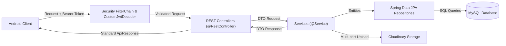

# 02. KIẾN TRÚC TỔNG THỂ HỆ THỐNG (ARCHITECTURE.md)

> **Phân loại**: Báo cáo kiến trúc hệ thống phục vụ chuyển giao và đánh giá kỹ thuật  
> **Vai trò**: Senior Software Engineer & Solution Architect  
> **Trạng thái**: [CONFIRMED] Trích xuất trực tiếp từ mã nguồn thực tế.

---

## 1. Sơ Đồ Ngữ Cảnh Hệ Thống (System Context Diagram)

```mermaid
flowchart TD
    User["Người dùng cuối (End-User)\n[Mobile Device]"]
    Admin["Quản trị viên (Admin)\n[Mobile Device / Dashboard]"]

    subgraph MobileApp["📱 Client Application (Android Jetpack Compose)"]
        UI_Layer["Tầng Giao Diện (Jetpack Compose UI)"]
        VM_Layer["Tầng Trạng Thái (ViewModels & StateFlow)"]
        Repo_Layer["Tầng Dữ Liệu (Repositories & PagingSource)"]
        Audio_Service["Tầng Âm Thanh (Media3 ExoPlayer Service)"]
        Local_Storage["Lưu trữ cục bộ (Room DB & DataStore)"]
    end

    subgraph BackendAPI["💻 Backend API (Spring Boot 3 - Java 21)"]
        Gateway["REST Endpoints / Context: /identity"]
        Security["Spring Security & JWT Filter"]
        Biz_Service["Tầng Nghiệp Vụ (Service Layer)"]
        Algo_Engine["Recommendation Engine (Item-Based CF & MMR)"]
        JPA_Repo["Spring Data JPA Repositories"]
    end

    subgraph External_Cloud["☁️ Hạ Tầng & Dịch Vụ Đám Mây"]
        MySQL[("MySQL 8.x Database\n(identity_service)")]
        Cloudinary["Cloudinary CDN\n(Lưu trữ Audio MP3 & Cover Image)"]
        Firebase["Google Firebase\n(Analytics, Crashlytics, Remote Config)"]
        AdMob["Google AdMob\n(Hiển thị Quảng Cáo)"]
    end

    User -->|Tương tác nghe nhạc & Playlist| UI_Layer
    Admin -->|Quản trị danh mục & User| UI_Layer
    UI_Layer --> VM_Layer
    VM_Layer --> Repo_Layer
    VM_Layer <--> Audio_Service
    Repo_Layer <--> Local_Storage

    Repo_Layer -->|HTTP/REST JSON (Retrofit)| Gateway
    Gateway --> Security
    Security --> Biz_Service
    Biz_Service <--> Algo_Engine
    Biz_Service --> JPA_Repo
    JPA_Repo <--> MySQL
    Biz_Service -->|Upload MP3/Ảnh| Cloudinary
    Audio_Service -->|Stream Audio Stream| Cloudinary
    UI_Layer -->|Track Events & Config| Firebase
    UI_Layer -->|Hiển thị Banner/Interstitial| AdMob
```

---

## 2. Kiến Trúc Chi Tiết Của Từng Thành Phần

### A. Front-end Architecture (Android Client) [CONFIRMED]
Mã nguồn phía Android tuân thủ mô hình **MVVM (Model - View - ViewModel)** kết hợp các nguyên lý của **Clean Architecture** (đặc biệt tách biệt rõ trong module `theme`):

1. **Presentation Layer (View & Composable)**:
   - Các Composable Functions thuần túy, không chứa logic nghiệp vụ.
   - Thư mục tổ chức theo tính năng: `view/Login/`, `view/Album/`, `view/Artist/`, `view/admin/`, `view/InProfile/`.
   - Cơ chế điều hướng: Quản lý tập trung qua `RecipeApp.kt` với AndroidX Navigation Compose và định nghĩa route sealed-class tại `Screen.kt`.
2. **State & ViewModel Layer**:
   - Quản lý trạng thái bằng `StateFlow` và `SharedFlow` theo nguyên lý Unidirectional Data Flow (UDF).
   - `PlayerManager.kt` (`c:\Users\ASUS\AndroidStudioProjects\App\app\src\main\java\com\example\app\viewmodel\PlayerManager.kt`): Đóng vai trò singleton cầu nối điều khiển ExoPlayer từ bất kỳ màn hình nào.
3. **Data Layer (Domain / Model)**:
   - **Remote**: Retrofit Interface (`ApiService.kt`) được tạo thông qua `ApiClient.kt` tích hợp bộ đánh chặn `TokenAuthenticator` tự động Refresh Token khi gặp lỗi `401 Unauthorized`.
   - **Local Cache**: `AppDatabase.kt` (Room Database version 3) lưu trữ thông tin nhạc đã tải về (`DownloadedSongEntity`).
   - **Preference Store**: `SessionManager.kt` và `DataStoreUtils.kt` lưu trữ Token JWT và cấu hình giao diện.
4. **Foreground Service**:
   - `MusicPlayerService.kt`: Chạy tiến trình nền phát nhạc độc lập với Activity lifecycle, duy trì phát nhạc ngay cả khi thoát ứng dụng ra màn hình chính.

---

### B. Back-end Architecture (Spring Boot REST API) [CONFIRMED]
Hệ thống Backend được thiết kế theo kiến trúc phân lớp chuẩn của Spring Boot (Layered Architecture):



1. **Security & Filter Layer**:
   - `SecurityConfig.java` (`D:\SpringBoot\identity-service-main\identity-service-main\src\main\java\com\devteria\identityservice\configuration\SecurityConfig.java`): Cấu hình bảo vệ tài nguyên bằng `oauth2ResourceServer(jwt)`.
   - `CustomJwtDecoder.java`: Giải mã và xác thực chữ ký token, đối chiếu với danh sách đen `InvalidatedTokenRepository` để ngăn chặn token đã đăng xuất.
2. **Controller Layer**:
   - Tiếp nhận HTTP requests, kiểm tra ràng buộc đầu vào (`@Valid`), ánh xạ vào DTOs và trả về chuẩn `ApiResponse<T>`.
3. **Service Layer**:
   - Chứa toàn bộ nghiệp vụ cốt lõi: Quản lý người dùng, bài hát, album, nghệ sĩ, playlist, báo cáo.
   - `RecommendationEngineService.java`: Triển khai thuật toán tính toán ma trận tương đồng (Cosine Similarity) và lọc cộng tác kết hợp thuật toán sắp xếp MMR (Maximal Marginal Relevance).
4. **Repository Layer**:
   - Sử dụng Spring Data JPA kế thừa `JpaRepository` với các câu lệnh truy vấn tùy biến qua `@Query`.
5. **Cross-Cutting Concerns**:
   - `GlobalExceptionHandler.java`: Bắt tập trung toàn bộ ngoại lệ và chuẩn hóa mã lỗi (`ErrorCode.java`).
   - `JpaAuditingConfig.java`: Tự động điền ngày tạo (`createdDate`) và người tạo (`createdBy`) qua `AbstractAuditEntity`.

---

## 3. Các Design Patterns Được Áp Dụng Trong Toàn Hệ Thống

| Design Pattern | Vị trí áp dụng trong mã nguồn | Đánh giá & Mục đích | Phân loại |
| :--- | :--- | :--- | :---: |
| **MVVM (Model-View-ViewModel)** | Toàn bộ module `app/src/main/java/com/example/app/` | Tách biệt hoàn toàn UI Compose khỏi logic nghiệp vụ và dữ liệu. | [CONFIRMED] |
| **Clean Architecture** | `app/src/main/java/com/example/app/theme/` (data, domain, ui) | Phân tách module giao diện động theo chuẩn Clean Architecture đa tầng. | [CONFIRMED] |
| **Singleton Pattern** | `ApiClient.kt`, `AppDatabase.kt`, `PlayerManager.kt` | Đảm bảo duy nhất 1 phiên kết nối HTTP, Database và Player trong suốt ứng dụng. | [CONFIRMED] |
| **Builder Pattern** | Lombok `@Builder` trên toàn bộ Backend DTOs & Entities | Giúp khởi tạo đối tượng bất biến, cú pháp ngắn gọn và an toàn. | [CONFIRMED] |
| **Repository Pattern** | Cả Frontend (`repository/*`) và Backend (`repository/*`) | Ẩn chi tiết lưu trữ dữ liệu (SQL / REST API) khỏi tầng nghiệp vụ. | [CONFIRMED] |
| **Interceptor / Filter Chain** | OkHttp `Interceptor` và Spring Security `SecurityFilterChain` | Can thiệp thêm header JWT, tự động làm mới token và kiểm tra bảo mật. | [CONFIRMED] |
| **Optimistic UI Update** | `FavoriteViewModel.kt#L45`, `PlaylistViewModel.kt` | Đổi trạng thái UI lập tức trước khi server phản hồi thành công, tự rollback nếu lỗi. | [CONFIRMED] |
| **Factory Pattern** | Toàn bộ `*ViewModelFactory.kt` trên Android | Khởi tạo ViewModels với các tham số phụ thuộc Repositories. | [CONFIRMED] |
