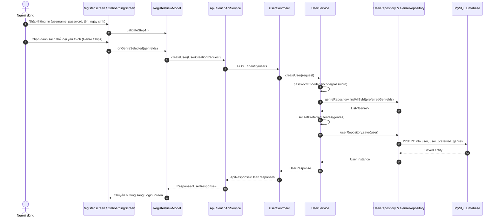
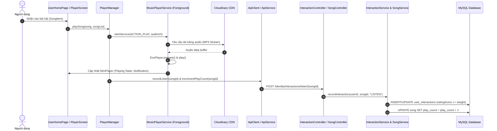
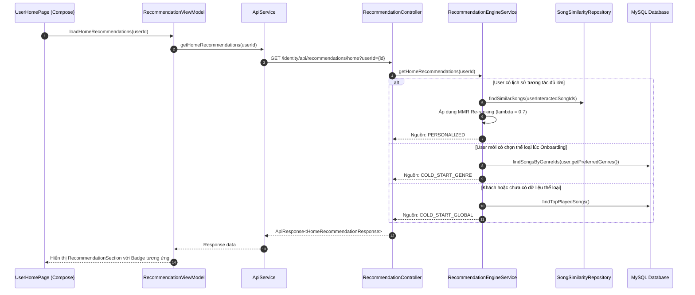
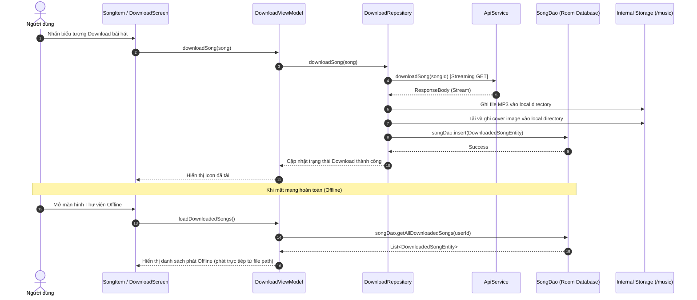

# 03. CÁC LUỒNG NGHIỆP VỤ END-TO-END (BUSINESS_FLOWS.md)

> **Phân loại**: Báo cáo phân tích luồng dữ liệu hệ thống (Traceability Matrix)  
> **Vai trò**: Senior Software Engineer & Solution Architect  
> **Trạng thái**: [CONFIRMED] Truy vết chính xác từ dòng code UI đến Controller, Service và Database.

---

## 1. Luồng Xác Thực & Đăng Ký Cold Start (Authentication & Onboarding Flow)

Luồng giải quyết bài toán Cold Start ngay khi người dùng tạo tài khoản mới.

* **Truy vết mã nguồn [CONFIRMED]**:
  - UI: `app/src/main/java/com/example/app/view/Login/RegisterScreen.kt` & `OnboardingScreen.kt`
  - ViewModel: `app/src/main/java/com/example/app/viewmodel/RegisterViewModel.kt#L120-L150`
  - API Client: `app/src/main/java/com/example/app/model/ApiService.kt#L57` (`POST users`)
  - Controller: `D:\SpringBoot\identity-service-main\identity-service-main\src\main\java\com\devteria\identityservice\controller\UserController.java#L33-L38`
  - Service: `D:\SpringBoot\identity-service-main\identity-service-main\src\main\java\com\devteria\identityservice\service\UserService.java#L60-L83`
  - Database: Bảng `user` và bảng liên kết `user_preferred_genres`.

---

## 2. Luồng Phát Nhạc Trực Tuyến & Ghi Nhận Lượt Nghe (Streaming & Interaction Flow)

Luồng kết hợp giữa việc phát nhạc qua ExoPlayer và gửi tương tác nền về máy chủ để phục vụ thuật toán Recommendation.

* **Truy vết mã nguồn [CONFIRMED]**:
  - UI: `app/src/main/java/com/example/app/view/UserHomePage.kt#L280` & `PlayerScreen.kt`
  - Manager: `app/src/main/java/com/example/app/viewmodel/PlayerManager.kt#L80-L130`
  - Service nền: `app/src/main/java/com/example/app/model/MusicPlayerService.kt#L70-L120`
  - Backend Controller: `InteractionController.java#L20` (`POST /interactions/listen/{songId}`) và `SongController.java#L110` (`POST /songs/{songId}/play`)
  - Backend Service: `InteractionService.java#L40` & `SongService.java#L220`
  - Database: Bảng `user_interactions` và `song`.

---

## 3. Luồng Gợi Ý Âm Nhạc Cá Nhân Hóa (Recommendation Flow)

Hệ thống tính toán thông minh dựa trên 3 tầng dự phòng: `PERSONALIZED`, `COLD_START_GENRE`, `COLD_START_GLOBAL`.

* **Truy vết mã nguồn [CONFIRMED]**:
  - UI Component: `app/src/main/java/com/example/app/view/general/RecommendationSection.kt`
  - ViewModel: `app/src/main/java/com/example/app/viewmodel/RecommendationViewModel.kt#L40-L75`
  - Backend Engine: `D:\SpringBoot\identity-service-main\identity-service-main\src\main\java\com\devteria\identityservice\service\RecommendationEngineService.java#L80-L240`
  - Thuật toán áp dụng: Item-Based Collaborative Filtering với Adjusted Cosine Similarity và Maximal Marginal Relevance (MMR) để đa dạng hóa danh sách đề xuất.

---

## 4. Luồng Tải Về & Phát Ngoại Tuyến (Offline Download & Playback Flow)

* **Truy vết mã nguồn [CONFIRMED]**:
  - UI: `app/src/main/java/com/example/app/view/InProfile/DownloadScreen.kt`
  - ViewModel: `app/src/main/java/com/example/app/viewmodel/DownloadViewModel.kt#L50-L100`
  - Repository: `app/src/main/java/com/example/app/model/repository/DownloadRepository.kt#L45-L120`
  - Local DB: `app/src/main/java/com/example/app/model/room/SongDao.kt` và `DownloadedSongEntity.kt`
  - Độc lập mạng: Phát qua `File(localAudioPath).toURI()` mà không cần gọi Retrofit hay Backend.
