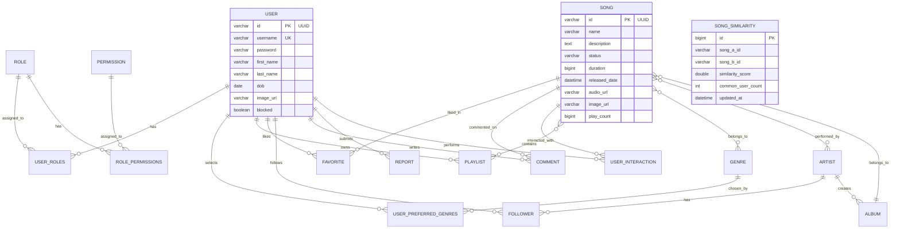

# 05. THIẾT KẾ CƠ SỞ DỮ LIỆU & MÔ HÌNH DỮ LIỆU (DATA_MODEL.md)

> **Phân loại**: Báo cáo thiết kế cơ sở dữ liệu & Toàn vẹn dữ liệu (Data Integrity Analysis)  
> **Vai trò**: Senior Software Engineer & Solution Architect  
> **Trạng thái**: [CONFIRMED] Trích xuất từ các Entity JPA (`com.devteria.identityservice.entity.*`) và Room Database (`com.example.app.model.room.*`).

---

## 1. Sơ Đồ Thực Thể Liên Kết (Entity-Relationship Diagram - ERD)

---

## 2. Chi Tiết Thực Thể Máy Chủ (Server-side Entities - MySQL)

### A. Core Identity & RBAC
1. **`User`** (`src/.../entity/User.java#L19`):
   - `id`: `String` (UUID generation).
   - `username`: `VARCHAR(255)`, `COLLATE utf8mb4_unicode_ci`, Unique constraint.
   - `password`: Chuỗi mã hóa BCrypt (cost factor 10).
   - `blocked`: `boolean default false` - cờ kiểm soát truy cập khi bị Admin xử lý.
   - Quan hệ: Many-to-Many với `Role`, Many-to-Many với `Genre` qua bảng `user_preferred_genres` (Cold Start Onboarding).
2. **`Role` & `Permission`**:
   - `Role`: Khóa chính là tên vai trò (`USER`, `ADMIN`).
   - `Permission`: Danh sách quyền hạn chi tiết (`CREATE_DATA`, `UPDATE_DATA`,...).
3. **`InvalidatedToken`** (`src/.../entity/InvalidatedToken.java`):
   - `id`: Mã token ID (`jti` dạng UUID).
   - `expiryTime`: Thời gian hết hạn của token, dùng cho cơ chế Blacklist khi user Logout.

---

### B. Catalog & Media Entities
1. **`Song`** (`src/.../entity/Song.java#L12`):
   - `id`: `String` (UUID).
   - `name`: Tên bài hát.
   - `audioUrl`: Đường dẫn phát stream trực tiếp từ Cloudinary CDN.
   - `imageUrl`: Ảnh bìa bài hát.
   - `duration`: Thời lượng bài hát tính bằng mili-giây/giây.
   - `playCount`: `bigint default 0` - tổng số lượt nghe tích lũy.
   - Quan hệ: Many-to-One với `Album`, Many-to-One với `Year`, Many-to-Many với `Genre` (`song_genre`), Many-to-Many với `Artist`.
2. **`Album` & `Artist`**:
   - `Artist`: Lưu thông tin nghệ sĩ, ảnh đại diện, tiểu sử (`bio` dạng `TEXT`).
   - `Album`: Chứa danh sách các bài hát thuộc album, bìa album và nghệ sĩ phát hành.
3. **`Playlist`**:
   - Danh sách phát do người dùng tạo hoặc hệ thống quản lý. Chứa tập hợp `Set<Song>` liên kết nhiều-nhiều.

---

### C. Recommendation & Machine Learning Tables [CONFIRMED]
1. **`SongSimilarity`** (`src/.../entity/SongSimilarity.java#L14`):
   - Bảng lưu trữ ma trận tương đồng giữa 2 bài hát, phục vụ truy vấn tốc độ cao (In-database Matrix Cache):
     - `song_a_id`, `song_b_id`: Cặp mã bài hát.
     - `similarity_score`: Điểm tương đồng tính theo Adjusted Cosine Similarity.
     - `common_user_count`: Số người dùng chung đã nghe cả 2 bài.
     - `updated_at`: Thời điểm cập nhật cuối (qua Cron Job hoặc Trigger Controller).
   - **Ràng buộc & Index [CONFIRMED]**:
     - `@UniqueConstraint(columnNames = {"song_a_id", "song_b_id"})`
     - `@Index(name = "idx_song_a", columnList = "song_a_id")`
     - `@Index(name = "idx_song_b", columnList = "song_b_id")`
2. **`UserInteraction`** (`src/.../entity/UserInteraction.java#L16`):
   - Bảng ghi nhận hành vi thô của người dùng:
     - `user_id` (FK tới `User`), `song_id` (FK tới `Song`).
     - `interactionType`: `"LISTEN"`, `"FAVORITE"`, `"PLAYLIST_ADD"`.
     - `ratingScore`: Điểm trọng số hành vi (ví dụ: nghe trọn vẹn = 1.0, thích = 2.0).

---

## 3. Cơ Sở Dữ Liệu Cục Bộ Thiết Bị (Client-side Room DB - SQLite)

*Trích xuất từ `AppDatabase.kt` & `DownloadedSongEntity.kt`:*

* **Tên bảng**: `downloaded_songs`
* **Khóa chính kết hợp (Composite PK)**: `["id", "userId"]` (đảm bảo hỗ trợ nhiều tài khoản người dùng khác nhau đăng nhập trên cùng một thiết bị mà không bị ghi đè bài hát tải về).
* **Cấu trúc trường**:
  - `id`: `String` (ID gốc của bài hát trên Server).
  - `userId`: `String` (ID của user đã tải).
  - `name`: Tên bài hát.
  - `artistName`: Tên nghệ sĩ.
  - `duration`: Thời lượng bài hát.
  - `localAudioPath`: Đường dẫn tuyệt đối tới file MP3 trên bộ nhớ nội bộ (`context.filesDir`).
  - `localImagePath`: Đường dẫn tuyệt đối tới file ảnh bìa trên thiết bị.
  - `downloadedByUser`: `Boolean = true`.

---

## 4. Đánh Giá Quản Lý Schema & Rủi Ro Toàn Vẹn Dữ Liệu (Data Integrity & Migration Risks)

| Vấn đề kỹ thuật | Vị trí phát hiện | Phân loại rủi ro | Chi tiết & Đánh giá tác động |
| :--- | :--- | :---: | :--- |
| **Thiếu công cụ Database Migration (Flyway/Liquibase)** | `application.yaml#L14` | 🔴 **HIGH** | Dự án đang dùng `hibernate.ddl-auto: update`. Rất nguy hiểm trên môi trường Production vì Hibernate không tự xoá cột cũ, không quản lý được phiên bản migration và có thể gây lock bảng khi sửa schema. |
| **Destructive Migration trên Room DB** | `AppDatabase.kt#L23` | 🟡 **MEDIUM** | Cấu hình `.fallbackToDestructiveMigration()`. Khi ứng dụng cập nhật phiên bản DB mới (ví dụ từ ver 3 lên ver 4), toàn bộ danh sách bài hát đã tải về của người dùng sẽ bị xóa sạch nếu không viết Migration script. |
| **Bảo đảm tính nhất quán giao dịch (Transaction)** | `SongService.java`, `UserService.java` | 🟡 **MEDIUM** | Khi upload file lên Cloudinary, nếu quá trình ghi database bị lỗi hoặc mạng ngắt giữa chừng, file trên Cloudinary không được rollback (gây rác lưu trữ và tốn dung lượng Cloud). |
| **Khóa ngoại không có Cascade Delete hợp lý** | `Song.java`, `Playlist.java` | 🟡 **MEDIUM** | Xóa bài hát có thể dẫn đến lỗi toàn vẹn ràng buộc (`DataIntegrityViolationException`) nếu bài hát đó đang nằm trong các Playlist hoặc danh sách Favorite của người dùng. |
