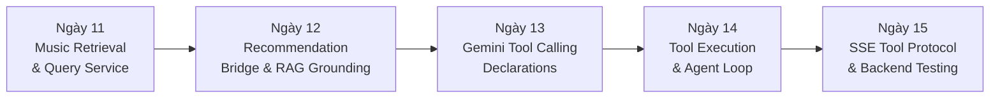
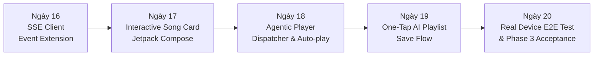

# KẾ HOẠCH TRIỂN KHAI GIAI ĐOẠN 3 (PHASE 3)
## NÂNG CẤP L4 RAG KHO NHẠC & FUNCTION CALLING / AI TOOLS ĐIỀU KHIỂN TRÌNH PHÁT
> **Dự án**: Music Streaming Platform (Android Jetpack Compose + Spring Boot 3.2.2 Java 21)  
> **Thời gian thực hiện**: 10 ngày làm việc (Ngày 11 đến Ngày 20)  
> **Phiên bản kế hoạch**: v3.0 (Chính thức)  
> **Trạng thái**: [PLANNING - READY FOR EXECUTION]

---

## 1. TỔNG QUAN & BÀI TOÁN NGHIỆP VỤ GIAI ĐOẠN 3

### 1.1. Hiện Trạng Sau Giai Đoạn 2 (Phase 2 Recap)
- **Đã đạt được**: 
  - Hệ thống AI Music Companion hoạt động ổn định với 3 Persona (DJ GenZ, Nhà Phê Bình, Tâm Giao).
  - Giao thức SSE Streaming Non-blocking mượt mà (độ trễ chunk đầu < 1.2s, bộ đệm UI 45ms chống giật màn hình).
  - Quản lý bộ nhớ hội thoại trượt 10 lượt (`Sliding Window Memory`) lưu trong MySQL.
  - Ngữ cảnh bài hát đang nghe (`<song_context>`) đã đồng bộ chuẩn xác với trình phát nhạc.
- **Hạn chế tồn tại**:
  - Khi người dùng hỏi các câu hỏi tra cứu kho nhạc thực tế của ứng dụng (ví dụ: *"Bài hát nào có lượt nghe nhiều nhất hiện tại?", "Tìm cho tui bài hát có lời 'gió mang cuộc tình ta...'", "Gợi ý 5 bài rap Việt hot trong kho nhạc"*), Gemini **chưa có quyền truy cập trực tiếp vào cơ sở dữ liệu** của ứng dụng nên không nắm được kho nhạc nội bộ.
  - Khi AI gợi ý một bài hát, người dùng **phải tự gõ tìm kiếm thủ công** để nghe, chưa có nút **"Phát ngay" (Play Now)** hoặc khả năng để AI **tự động bật bài hát đó trên trình phát (Agentic Control)**.

### 1.2. Mục Tiêu Giai Đoạn 3 (Phase 3 Core Objectives)
Biến AI Music Companion từ một chatbot hội thoại thụ động thành một **AI Music Agent thực thụ (Agentic AI Companion)**:
1. **L4 Music Library RAG (Retrieval-Augmented Generation)**:
   - Trang bị khả năng truy xuất cơ sở dữ liệu kho nhạc thời gian thực (Full-text keyword search, Lyrics matching, Bảng xếp hạng lượt nghe `play_count`, Thể loại, Nghệ sĩ).
   - Tích hợp trực tiếp với thuật toán gợi ý `RecommendationEngineService` (Item-Based CF & MMR) để cung cấp danh sách bài hát cá nhân hóa theo từng người nghe.
2. **Gemini Function Calling & AI Tools Engine**:
   - Khai báo các Tool chuẩn OpenAPI cho Google Gemini (`search_music_library`, `get_top_trending_songs`, `get_personalized_recommendations`, `play_song`, `queue_song`, `create_ai_playlist`).
   - Xây dựng vòng lặp điều phối tự động: Prompt -> Gemini Function Call -> Spring Boot Execution -> Gemini Synthesis -> Trả về Client.
3. **Giao Diện Android Tương Tác & Điều Khiển Trình Phát**:
   - Widget **Thẻ bài hát tương tác (`AiSongCardWidget`)** nhúng trực tiếp trong bong bóng chat: Hiển thị ảnh bìa, tên bài hát, ca sĩ, nút **"Phát ngay"** và **"Thêm vào playlist"**.
   - **Tự động kích hoạt trình phát (Auto Player Dispatcher)**: Khi người dùng bảo *"Bật bài I Love You 3000"*, AI vừa trả lời duyên dáng vừa tự động phát bài hát đó trên `PlayerManager` / `ExoPlayer` của điện thoại.
   - **Tạo Playlist AI 1 Chạm**: Cho phép người dùng lưu toàn bộ danh sách bài hát AI gợi ý thành Playlist cá nhân trong nháy mắt.

---

## 2. KIẾN TRÚC HỆ THỐNG GIAI ĐOẠN 3 (ARCHITECTURE)

```mermaid
flowchart TD
    subgraph Mobile ["Android Client (Jetpack Compose)"]
        UI["AiCompanionScreen"]
        VM["AiCompanionViewModel"]
        PM["PlayerManager (ExoPlayer)"]
        Widget["AiSongCardWidget (Nút Phát Ngay)"]
        AutoDisp["AgenticPlayerDispatcher"]
    end

    subgraph Backend ["Spring Boot 3.2.2 Backend"]
        Controller["AiChatController (/ai/chat/stream)"]
        RAG["LibraryRagContextBuilder"]
        Retrieval["MusicRetrievalService"]
        ToolService["GeminiToolCallingService"]
        RecService["RecommendationEngineService (CF + MMR)"]
        DB[(MySQL 8.x - Song, Artist, Playlist)]
    end

    subgraph LLM ["Google Gemini 3.5 Flash Lite"]
        GeminiAPI["Gemini API (streamGenerateContent + Tools)"]
    end

    UI -->|1. Prompt: 'Bật bài hát hot nhất'| VM
    VM -->|2. POST /ai/chat/stream| Controller
    Controller -->|3. Chuẩn bị Tools & Context| ToolService
    ToolService -->|4. Gọi Gemini kèm Tool Declarations| GeminiAPI
    GeminiAPI -->|5. Trả về Function Call: get_top_trending_songs()| ToolService
    ToolService -->|6. Thực thi Tool qua MusicRetrievalService| Retrieval
    Retrieval -->|7. Query top play_count| DB
    Retrieval -->|8. Trả về bài hát thực tế| ToolService
    ToolService -->|9. Gửi kết quả Tool về Gemini| GeminiAPI
    GeminiAPI -->|10. Stream câu trả lời + Lệnh playSong()| Controller
    Controller -->|11. SSE Stream (Text Chunks + ToolActions + SongCards)| VM
    VM -->|12. Render bong bóng + Thẻ bài hát| Widget
    VM -->|13. Kích hoạt Auto-play| AutoDisp
    AutoDisp -->|14. playSong(songId)| PM
    Widget -->|15. Người dùng bấm 'Phát ngay'| PM
```

---

## 3. PHÂN KỲ TRIỂN KHAI CHI TIẾT (10 NGÀY)

### SPRINT 3A: BACKEND RAG & GEMINI FUNCTION CALLING ENGINE (NGÀY 11 - 15)



#### Ngày 11: Module Truy Xuất Dữ Liệu Kho Nhạc (`MusicRetrievalService`)
- **Mục tiêu**: Xây dựng tầng service nghiệp vụ phục vụ tìm kiếm thông minh và thống kê dữ liệu kho nhạc thực tế từ cơ sở dữ liệu.
- **Công việc chi tiết**:
  1. Tạo `com.devteria.identityservice.service.MusicRetrievalService`:
     - `searchSongs(String query, String genreName, String artistName, int limit)`: Tìm kiếm đa tiêu chí (theo tên bài hát, lời bài hát trong `description`, thể loại, ca sĩ).
     - `getTopTrendingSongs(int limit)`: Truy vấn danh sách bài hát có `play_count` cao nhất (kết hợp `SongRepository.findTop10ByOrderByPlayCountDesc()`).
     - `findSongsByLyricsOrKeyword(String lyricSnippet, int limit)`: Tìm kiếm bài hát dựa trên trích đoạn ca từ hoặc từ khóa tâm trạng.
  2. Tạo DTOs phục vụ Tool Data Transfer:
     - `GroundedSongDto` (chứa `id`, `name`, `artistNames`, `genreNames`, `playCount`, `duration`, `imageUrl`, `audioUrl`).
  3. Viết Unit Test cho `MusicRetrievalServiceTest` (đảm bảo hydrate đủ thông tin nghệ sĩ, thể loại và chống N+1 query).

#### Ngày 12: Tích Hợp Recommendation Engine Bridge & RAG Context Builder
- **Mục tiêu**: Kết nối thuật toán gợi ý học máy có sẵn (`RecommendationEngineService`) với AI Companion và cấu trúc khối dữ liệu Grounding.
- **Công việc chi tiết**:
  1. Tạo `com.devteria.identityservice.service.LibraryRagContextBuilder`:
     - Tự động lấy profile người dùng (`preferredGenres`, lịch sử tương tác `UserInteraction`) để gọi `RecommendationEngineService.getPersonalizedRecommendations()`.
     - Chuyển đổi danh sách gợi ý thành khối ngữ cảnh `<retrieved_music_library>` có cấu trúc XML an toàn.
  2. Định dạng chuẩn hóa Grounding Data:
     ```xml
     <retrieved_music_library>
       <song id="015b04ab-..." title="I Love You 3000" artists="Stephanie Poetri" genres="Pop" play_count="1520" />
     </retrieved_music_library>
     ```
  3. Bổ sung cơ chế bộ đệm In-Memory Cache (Redis/Caffeine 5 phút) cho các truy vấn bảng xếp hạng top bài hát để giảm tải MySQL.

#### Ngày 13: Định Nghĩa Gemini Function Calling Tools
- **Mục tiêu**: Khai báo đặc tả JSON Schema các công cụ mà Gemini được phép kích hoạt trong cuộc trò chuyện.
- **Công việc chi tiết**:
  1. Tạo `com.devteria.identityservice.service.GeminiToolCallingService`:
     - Khai báo 6 công cụ (Tools) gửi trong body gọi Gemini REST API:
       1. `search_music(query, genre, artist, limit)`: Tìm kiếm bài hát trong kho ứng dụng.
       2. `get_top_trending(limit)`: Lấy các bài hát thịnh hành nhất theo lượt nghe.
       3. `get_recommended_for_user(mood, limit)`: Lấy bài hát cá nhân hóa dựa trên gu người dùng.
       4. `play_music(song_id, song_name)`: Phát bài hát trực tiếp trên điện thoại người dùng.
       5. `queue_music(song_id, song_name)`: Thêm bài hát vào danh sách chờ phát.
       6. `create_playlist(playlist_name, song_ids)`: Tạo playlist mới từ các bài hát gợi ý.
  2. Cấu hình cờ `tool_config`: `mode: "AUTO"` để Gemini tự quyết định khi nào cần gọi Tool dựa trên câu hỏi của người dùng.

#### Ngày 14: Bộ Điều Phối & Vòng Lặp Thực Thi Tool (Agentic Tool Dispatcher)
- **Mục tiêu**: Xử lý phản hồi `functionCall` từ Gemini, thực thi truy vấn nghiệp vụ trong Spring Boot và gửi kết quả `functionResponse` trở lại cho Gemini tổng hợp câu trả lời cuối.
- **Công việc chi tiết**:
  1. Xây dựng Agentic Execution Loop trong `GeminiClientService`:
     - Kiểm tra nếu Gemini chunk trả về `functionCall`:
       - Trích xuất tên tool và tham số (`args`).
       - Gọi tương ứng `MusicRetrievalService` hoặc `PlaylistService`.
       - Giới hạn tối đa **3 vòng lặp (Max 3 Tool Iterations)** để ngăn chặn đệ quy vô hạn (Loop Prevention).
  2. Bảo mật phân quyền IDOR:
     - Khi gọi `create_playlist`, tự động gán `userId` từ JWT Authentication của phiên hiện tại, nghiêm cấm nhận `userId` từ tham số do LLM sinh ra.
  3. Xử lý kịch bản dữ liệu rỗng:
     - Nếu Tool tìm kiếm không thấy bài hát nào trong DB, trả về thông báo rõ ràng để AI gợi ý bài tương tự hoặc khuyên người dùng thử từ khóa khác thay vì báo lỗi hệ thống.

#### Ngày 15: Mở Rộng Giao Thức SSE Stream & Kiểm Thử Tích Hợp Backend
- **Mục tiêu**: Định nghĩa các gói tin SSE mở rộng chuyển tải dữ liệu thẻ bài hát và hành động phát nhạc xuống client, kèm bộ kiểm thử tự động.
- **Công việc chi tiết**:
  1. Mở rộng DTO `ChatStreamChunk`:
     - Thêm trường `toolAction`: `{ "action": "PLAY_SONG", "songId": "...", "songName": "..." }`.
     - Thêm trường `suggestedSongs`: Danh sách `GroundedSongDto` để client render thẻ bài hát.
  2. Cập nhật `AiChatController` gửi các sự kiện SSE có cấu trúc:
     - `data: {"delta": "Tui đã bật bài I Love You 3000 cho cậu rồi nè...", "toolAction": {...}, "suggestedSongs": [...]}`
  3. Viết bộ kiểm thử tích hợp `AiCompanionToolCallingIntegrationTest.java`:
     - Kiểm thử kịch bản hỏi bài hát hot -> Verify Tool `get_top_trending` được kích hoạt và trả về đúng dữ liệu từ MySQL.
     - Kiểm thử kịch bản lệnh phát nhạc -> Verify `toolAction.action == "PLAY_SONG"`.

---

### SPRINT 3B: ANDROID INTERACTIVE WIDGETS & PLAYER DISPATCHER (NGÀY 16 - 20)



#### Ngày 16: Mở Rộng SSE Stream Client & Data Models
- **Mục tiêu**: Nâng cấp tầng Network Android để phân tích các sự kiện Tool Action và danh sách bài hát gợi ý từ luồng SSE.
- **Công việc chi tiết**:
  1. Mở rộng `StreamEvent` trong `SseStreamClient.kt`:
     - `StreamEvent.ToolAction(val action: String, val songId: String, val songName: String)`
     - `StreamEvent.SongCards(val songs: List<SongCardData>)`
  2. Cập nhật `UiChatMessage`:
     - Thêm trường `suggestedSongs: List<SongCardData> = emptyList()`
     - Thêm trường `triggeredToolAction: ToolActionData? = null`
  3. Viết Unit Test `SseStreamClientToolParsingTest.kt` kiểm tra giải mã chuẩn JSON payload chứa Tool Action.

#### Ngày 17: Xây Dựng UI Widget Thẻ Bài Hát Tương Tác (`AiSongCardWidget.kt`)
- **Mục tiêu**: Tạo giao diện thẻ bài hát đẹp mắt, trực quan ngay bên dưới nội dung văn bản của bong bóng chat AI.
- **Công việc chi tiết**:
  1. Tạo Composable `AiSongCardWidget.kt`:
     - Hiển thị ảnh bìa bài hát (`AsyncImage` Coil với placeholder và hiệu ứng bo góc 12dp).
     - Tên bài hát (đậm, max 1 dòng), tên nghệ sĩ thể hiện (màu phụ đề `onSurfaceVariant`).
     - Badge thời lượng và số lượt nghe.
     - Nút icon **Play ▶** (Chuyển thành sóng âm Equalizer động nếu bài hát đang được phát).
     - Nút icon **Thêm vào hàng đợi ➕**.
  2. Tạo Composable `AiSongListCarousel.kt`:
     - Nếu AI gợi ý từ 2 bài hát trở lên, hiển thị dạng danh sách vuốt ngang mượt mà (`LazyRow` với `spacedBy(8.dp)`), có chỉ báo số lượng bài hát.

#### Ngày 18: Tích Hợp Điều Khiển Trình Phát Nhạc Tự Động (`AgenticPlayerDispatcher.kt`)
- **Mục tiêu**: Kết nối sự kiện `ToolAction` từ AI trực tiếp vào `PlayerManager` và `MusicPlayerService` để tự động phát nhạc khi người dùng yêu cầu.
- **Công việc chi tiết**:
  1. Tạo `com.example.app.viewmodel.ai.AgenticPlayerDispatcher`:
     - Lắng nghe sự kiện `PLAY_SONG`: Tìm bài hát trong danh sách gợi ý hoặc gọi API tải chi tiết bài hát -> Chuyển vào `PlayerManager.playSong(song)`.
     - Lắng nghe sự kiện `QUEUE_SONG`: Thêm vào hàng đợi phát `PlayerManager.addToQueue(song)`.
     - Lắng nghe sự kiện `PAUSE_PLAYER` / `RESUME_PLAYER`.
  2. Hiển thị thông báo phản hồi (Feedback Toast/Snackbar):
     - Hiển thị snackbar nổi: *"🎵 DJ GenZ đang phát: [Tên bài hát]..."* kèm nút hoàn tác.
  3. Tự động đồng bộ thanh `CurrentSongContextBanner` trên đỉnh màn hình trò chuyện ngay khi bài hát bắt đầu phát.

#### Ngày 19: Luồng Tạo Playlist Từ AI Bằng 1 Chạm (`AiPlaylistSaveBottomSheet.kt`)
- **Mục tiêu**: Cung cấp tính năng biến danh sách bài hát AI vừa gợi ý thành một Playlist cá nhân trong thư viện người dùng chỉ với 1 click.
- **Công việc chi tiết**:
  1. Thiết kế nút hành động **"Lưu thành Playlist" 📑** ở cuối danh sách bài hát gợi ý trong tin nhắn AI.
  2. Tạo BottomSheet `AiPlaylistSaveBottomSheet.kt`:
     - Cho phép người dùng chỉnh sửa tên Playlist (được AI tự động đặt tên theo chủ đề, ví dụ: *"Vibe Đêm Khuya Cùng DJ GenZ"*).
     - Cho phép chọn/bỏ chọn từng bài hát trước khi lưu.
     - Bấm nút **"Xác nhận tạo"**: Gọi API `/playlists` của backend để lưu vào thư viện cá nhân.
  3. Cập nhật tức thời `PlaylistViewModel` để người dùng thấy playlist mới xuất hiện ngay trên tab Thư viện.

#### Ngày 20: Kiểm Thử E2E Toàn Diện Giai Đoạn 3 & Nghiệm Thu
- **Mục tiêu**: Kiểm thử thực tế trên thiết bị thật qua Wi-Fi ADB, chạy bộ đánh giá 40 kịch bản RAG & Tool Calling và xuất báo cáo nghiệm thu.
- **Công việc chi tiết**:
  1. Xây dựng bộ dữ liệu đánh giá 40 kịch bản `ai_companion_phase3_eval_suite.json`:
     - 15 kịch bản RAG Kho Nhạc (Tìm bài theo lyric, tìm bài theo nghệ sĩ, hỏi top bài hát nghe nhiều nhất).
     - 15 kịch bản Function Calling (Yêu cầu phát nhạc, xếp hàng đợi, tạo playlist).
     - 10 kịch bản Chống Lỗi & Xử lý Ngoại lệ (Bài hát không tồn tại, mạng gián đoạn khi gọi tool).
  2. Chạy tự động kiểm thử E2E trên Android và Spring Boot:
     - Backend: `AiCompanionPhase3EvaluationTest.java` (yêu cầu đạt 100% pass rate).
     - Android: `AiCompanionPhase3E2ETest.kt` (mô phỏng tương tác UI và ExoPlayer state).
  3. Xuất tài liệu nghiệm thu chính thức: `output/PHASE_3_EVALUATION_REPORT.md`.

---

## 4. BẢNG TIÊU CHÍ NGHIỆM THU (ACCEPTANCE CRITERIA)

| Mã tiêu chuẩn | Tên tiêu chí | Yêu cầu kỹ thuật đo lường được |
| :--- | :--- | :--- |
| **AC-RAG-01** | Độ chính xác kho nhạc (Library Grounding) | **100%** bài hát xuất hiện trong thẻ tương tác phải có `id` thực tế tồn tại trong cơ sở dữ liệu MySQL của ứng dụng. Tuyệt đối không sinh bài hát ảo giác. |
| **AC-RAG-02** | Xử lý dữ liệu rỗng (Empty Fallback) | Khi không tìm thấy bài hát thỏa mãn câu hỏi trong kho, AI phải giải thích lịch sự và gợi ý bài tương tự, không báo lỗi hệ thống hay trả về thẻ rỗng. |
| **AC-TOOL-01** | Kiểm soát vòng lặp Tool (Loop Prevention) | Giới hạn tối đa **3 vòng lặp Tool** cho một lượt trò chuyện. Nếu vượt quá, dừng gọi tool và tổng hợp câu trả lời từ dữ liệu đã có. |
| **AC-TOOL-02** | Bảo mật phân quyền IDOR | Lệnh tạo playlist `create_ai_playlist` bắt buộc gán quyền sở hữu theo `userId` trích xuất từ JWT token, nghiêm cấm nhận `userId` từ LLM. |
| **AC-UI-01** | Tương tác thẻ bài hát (Card Interaction) | Khi người dùng bấm nút "Phát ngay" trên thẻ bài hát, trình phát nhạc (`PlayerManager`) phải chuyển bài và phát trong **< 300ms**, không làm gián đoạn luồng stream chat. |
| **AC-UI-02** | Tự động phát khi AI ra lệnh (Auto-Play Action) | Khi Gemini gọi tool `play_song`, client tự động tải audio và bắt đầu phát, hiển thị Snackbar thông báo mà không cần người dùng chạm thêm thao tác nào. |
| **AC-PERF-01** | Độ trễ gọi Tool đầu tiên | Thời gian từ khi gửi prompt đến khi Tool đầu tiên được thực thi trên backend phải đạt **< 1.8s**. |

---

## 5. MA TRẬN RỦI RO & GIẢI PHÁP PHÒNG NGỪA

| Rủi ro kỹ thuật | Mức độ | Hậu quả | Giải pháp phòng ngừa & Xử lý |
| :--- | :---: | :--- | :--- |
| **Gemini gọi Tool lặp vô tận** | Cao | Gây treo thread, cạn kiệt tài nguyên API | Áp dụng biến đếm `toolCallCounter <= 3`. Quá 3 lần sẽ ép chuyển sang chế độ trả lời thuần văn bản. |
| **Song ID không tồn tại trong DB** | Trung bình | Gây lỗi 404 khi người dùng bấm phát | Tầng `MusicRetrievalService` luôn validate kiểm tra `songRepository.existsById()` trước khi đính kèm vào thẻ bài hát. |
| **Lỗi xung đột Audio Focus trên điện thoại** | Trung bình | Nhạc phát đè lên âm thanh hệ thống | `AgenticPlayerDispatcher` gọi thông qua `PlayerManager`, tuân thủ chuẩn `AudioManager.OnAudioFocusChangeListener` của Android. |
| **Lạm dụng tạo Playlist rác** | Thấp | Tốn dung lượng DB MySQL | Giới hạn mỗi người dùng chỉ được tạo tối đa 5 Playlist AI / ngày qua `AiChatGuardService`. |

---

## 6. PHÂN CÔNG & CAM KẾT TRIỂN KHAI

- **Repository Backend**: `D:\SpringBoot\identity-service-main\identity-service-main` (Nhánh: `backup`)
- **Repository Frontend**: `c:\Users\ASUS\AndroidStudioProjects\App` (Nhánh: `main`)
- **Nguyên tắc an toàn**: Toàn bộ API Key giữ nguyên trong `.env`, không commit lên GitHub.
- **Tiến độ**: Bắt đầu ngay từ **Sprint 3A - Ngày 11** theo đúng quy trình phát triển và kiểm thử liên tục trên máy thật.
